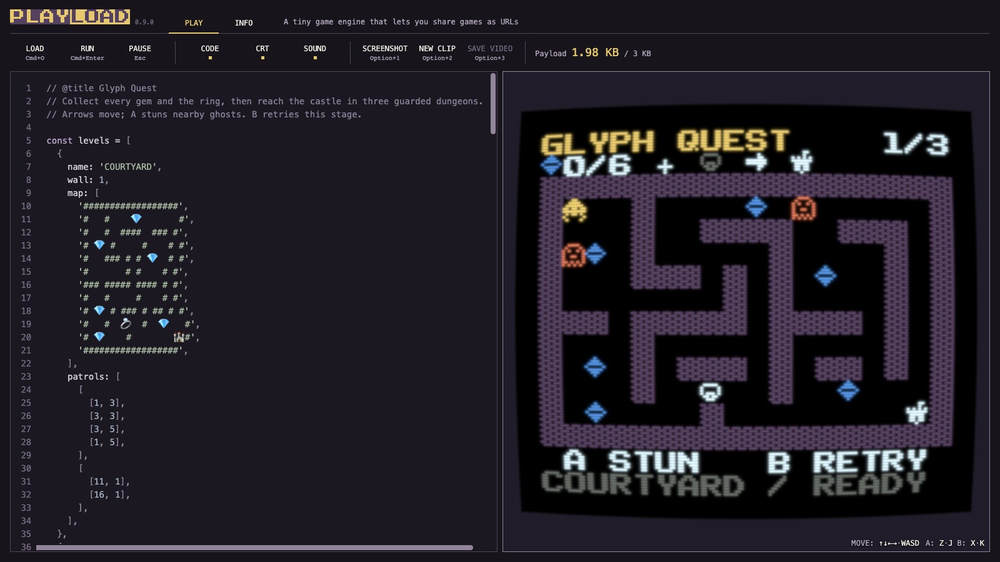
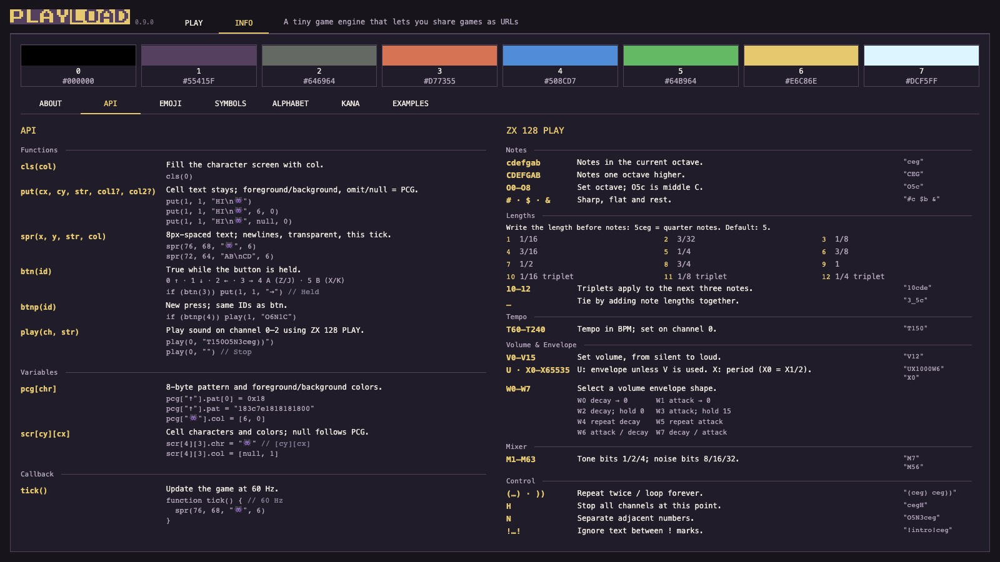
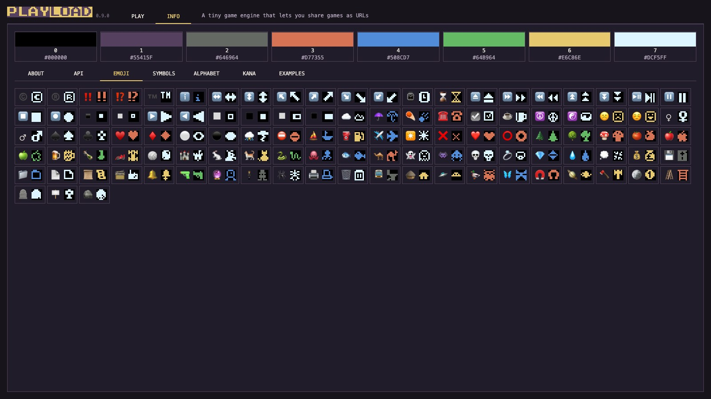
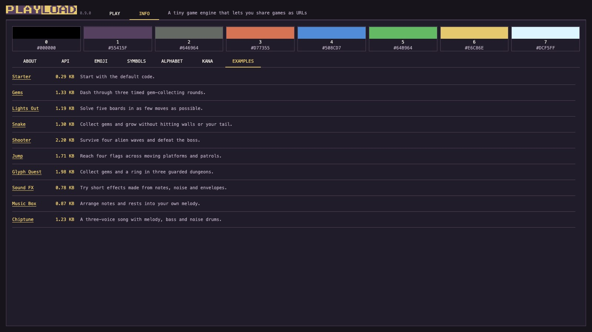

<p align="center">
  
</p>

<p align="center">
  A tiny game engine that lets you share games as URLs
</p>

<h3 align="center"><a href="https://kitao.dev/playload/">Open Playload →</a></h3>

<p align="center">
  <a href="assets/images/example-glyph-quest.jpg"></a>
  <a href="assets/images/info-api.jpg"></a><br>
  <a href="assets/images/info-emoji.jpg"></a>
  <a href="assets/images/info-examples.jpg"></a>
</p>

## Specifications

- Up to 3 KB of compressed JavaScript
- API with 6 functions, 2 variables and 1 callback
- 160 × 144 pixels, 8 colors, CRT display
- Built-in 8 × 8 Unicode letters, symbols and emoji
- ZX 128 PLAY-compatible, 3 sound channels
- 4-direction and 2-button input
- A complete game in one URL — a **playable payload**

## Create and share

Edit your game in the **CODE** editor and press **Run**. The URL updates as you edit:
share it to send the game and its code, or bookmark it to save that version.
Start your code with `// @title My Game` to name the browser tab and bookmark.

## Support Playload

If you enjoy Playload, please consider starring the project on GitHub.
It helps more people discover the project.

Playload is free to use. If you would like to support its development, you can
[sponsor me on GitHub](https://github.com/sponsors/kitao) or
[buy me a coffee on Ko-fi](https://ko-fi.com/H2H27VDKD).
Your support helps cover development costs and gives me more time to improve Playload.
Thank you for helping keep it going.

## Run locally

Requires **Node.js 24+**.

```sh
git clone https://github.com/kitao/playload.git
cd playload
npm ci
npm run dev
```

The development server builds the tool, watches its sources, and opens Playload in your default browser.

## License

Playload's code and documentation are licensed under [MIT](LICENSE).

Bundled third-party materials retain their own licenses:

- [Public Pixel](https://ggbot.itch.io/public-pixel-font): CC0
- [Unscii-8](https://github.com/viznut/unscii): public domain / CC0
- [Twemoji color reference](https://github.com/jdecked/twemoji): [CC BY 4.0](https://creativecommons.org/licenses/by/4.0/)
- [Misaki Gothic](https://littlelimit.net/misaki.htm): use, modification and redistribution permitted, including commercial use
- [Unicode data](https://www.unicode.org/Public/17.0.0/): [Unicode License v3](data/fonts/unicode-LICENSE.txt)
- [DB8](https://pixeljoint.com/forum/forum_posts.asp?TID=26050) (palette): Richard Fhager (DawnBringer)
- [CRT-Lottes](https://github.com/libretro/glsl-shaders/blob/e808ca09c699db7a843154cf7dc4dfd766d18a8a/crt/shaders/crt-lottes.glsl): public domain
- [AY volume measurements](https://github.com/mamedev/mame/blob/dd06c01bbbd7d0c1c8aefa477c095861c7f8bf31/src/devices/sound/ay8910.cpp): public domain
- [Prism](https://prismjs.com/): MIT
- [Press Start 2P](https://fonts.google.com/specimen/Press+Start+2P) (logo and favicon): SIL OFL 1.1
- [emu2149](https://github.com/digital-sound-antiques/emu2149) (test reference): MIT
